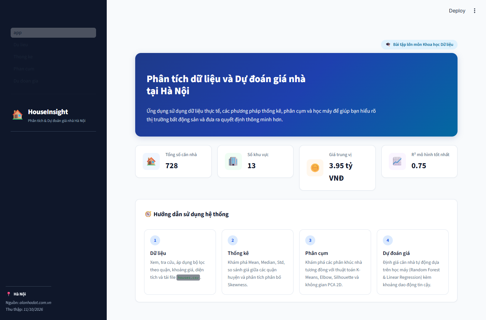

# HouseInsight - Phân tích và Dự đoán giá nhà tại Hà Nội

Ứng dụng Web tương tác khai phá dữ liệu bất động sản và nhúng mô hình học máy (Machine Learning) để dự đoán giá nhà ở tại TP. Hà Nội. Dự án được xây dựng bằng Python và Streamlit, tuân thủ quy trình khoa học dữ liệu hoàn chỉnh từ thu thập, làm sạch, thống kê mô tả, phân cụm K-Means/PCA đến huấn luyện mô hình hồi quy.



---

## 1. Cấu trúc thư mục dự án

```
house_app/
├── app.py                      # Trang chủ giới thiệu & tổng quan hệ thống
├── pages/
│   ├── 1_Du_lieu.py            # Phần I: Khám phá, lọc & tải dữ liệu houses.csv
│   ├── 2_Thong_ke.py           # Phần II: Bảng results2.csv, so sánh khu vực & phân bố
│   ├── 3_Phan_cum.py           # Phần III: K-Means, Elbow, Silhouette & PCA 2D
│   └── 4_Du_doan_gia.py        # Phần IV: Nhúng mô hình dự đoán giá & Feature Importance
├── src/
│   ├── __init__.py
│   ├── ui.py                   # Cấu hình giao diện, Theme Navy & Custom CSS
│   ├── crawl.py                # Thu thập dữ liệu từ Alonhadat.com.vn
│   ├── prepare_dataset.py      # Tích hợp dữ liệu kiểm chứng thực tế
│   ├── clean.py                # Làm sạch dữ liệu, xử lý IQR & xuất houses.csv
│   ├── stats.py                # Tính toán thống kê mô tả & xuất results2.csv
│   ├── clustering.py           # K-Means, tính Elbow, Silhouette Score, PCA 2D
│   └── model.py                # Huấn luyện Pipeline hồi quy (Linear & Random Forest)
├── models/                     # Thư mục lưu trữ mô hình và metrics
│   ├── model_lr.joblib         # Mô hình Linear Regression đã huấn luyện
│   ├── model_rf.joblib         # Mô hình Random Forest Regressor đã huấn luyện
│   └── metrics.json            # Chỉ số MAE, RMSE, R² trên tập Train và Test
├── data/                       # Dữ liệu thô thu thập ban đầu
│   └── raw_houses.json
├── figures/                    # Biểu đồ phân tích và ảnh chụp màn hình ứng dụng
├── clusterPlot.py              # Công cụ dòng lệnh (CLI) chạy phân cụm K-Means
├── predictPrice.py             # Công cụ dòng lệnh (CLI) dự đoán giá nhà nhanh
├── houses.csv                  # File dữ liệu sạch nghiệm thu (728 bản ghi)
├── results2.csv                # Bảng thống kê Mean, Median, Std (toàn bộ & từng quận)
├── clean_meta.json             # Nhật ký số lượng bản ghi loại bỏ khi làm sạch
├── report.md                   # Báo cáo khoa học chi tiết toàn bộ dự án
├── requirements.txt            # Danh sách thư viện phụ thuộc
└── README.md                   # Hướng dẫn cài đặt và vận hành
```

---

## 2. Yêu cầu môi trường

- **Hệ điều hành:** Windows / macOS / Linux.
- **Phiên bản Python:** Python 3.10 trở lên (khuyến nghị Python 3.11 hoặc 3.12).
- **Trình duyệt web:** Google Chrome, Microsoft Edge, Firefox, Safari.

---

## 3. Cài đặt môi trường ảo và thư viện

### Bước 1: Khởi tạo và kích hoạt môi trường ảo (Virtual Environment)

**Trên Windows (PowerShell):**
```powershell
# Di chuyển vào thư mục dự án
cd house_app

# Tạo môi trường ảo .venv
python -m venv .venv

# Kích hoạt môi trường ảo
.\.venv\Scripts\Activate.ps1
```

*(Nếu gặp lỗi PowerShell ExecutionPolicy, mở PowerShell quyền Admin và chạy: `Set-ExecutionPolicy RemoteSigned -Scope CurrentUser`)*

**Trên Linux / macOS:**
```bash
cd house_app
python3 -m venv .venv
source .venv/bin/activate
```

### Bước 2: Cài đặt các thư viện phụ thuộc

```bash
pip install --upgrade pip
pip install -r requirements.txt
```

---

## 4. Hướng dẫn chạy các giai đoạn (Tuần tự)

Mọi tệp dữ liệu sạch (`houses.csv`), thống kê (`results2.csv`) và mô hình học máy (`models/`) đã được tính toán và lưu sẵn. Nếu bạn muốn chạy lại toàn bộ quy trình từ đầu:

### Bước 1: Thu thập và chuẩn bị dữ liệu
```bash
# Thu thập dữ liệu từ alonhadat.com.vn và tích hợp dữ liệu kiểm chứng
python src/prepare_dataset.py
```

### Bước 2: Làm sạch dữ liệu và xuất `houses.csv`
```bash
python src/clean.py
```
*Kết quả:* Tạo tệp `houses.csv` gồm 728 dòng, được chuẩn hóa đơn vị, lọc ngoại lai và sắp xếp giá bán tăng dần.

### Bước 3: Tính toán thống kê mô tả và xuất `results2.csv`
```bash
python src/stats.py
```
*Kết quả:* Tạo tệp `results2.csv` chứa dòng `all` và 13 quận/huyện, đồng thời xuất các biểu đồ phân bố vào thư mục `figures/`.

### Bước 4: Huấn luyện và lưu trữ các mô hình học máy
```bash
python src/model.py
```
*Kết quả:* Huấn luyện hai mô hình hồi quy trên tập Train (80%), đánh giá trên tập Test (20%), lưu `models/model_lr.joblib`, `models/model_rf.joblib`, `models/metrics.json` và biểu đồ Feature Importance.

---

## 5. Chạy ứng dụng Web Streamlit

Khởi chạy ứng dụng Web cục bộ bằng lệnh:
```bash
streamlit run app.py
```

Sau khi chạy lệnh, trình duyệt web sẽ tự động mở tại địa chỉ:
```
http://localhost:8501
```

### Các tính năng chính trên Web App:
1. **Trang chủ (`app.py`):** Tổng quan dự án, số liệu KPI thời gian thực, hướng dẫn điều hướng và lưu ý pháp lý.
2. **Trang 1 - Dữ liệu (`1_Du_lieu.py`):** Lọc theo Quận/Huyện, Khoảng giá, Khoảng diện tích; xem tỷ lệ khuyết thiếu `N/a` và tải xuống tệp `houses.csv`.
3. **Trang 2 - Thống kê (`2_Thong_ke.py`):** Bảng `results2.csv`, top 3 căn rẻ nhất và đắt nhất, so sánh đơn giá giữa các quận và biểu đồ phân bố kèm nhận xét Skewness tự động.
4. **Trang 3 - Phân cụm (`3_Phan_cum.py`):** Chọn đặc trưng, kéo slider $k$ ($2 - 10$), quan sát đồ thị Elbow & Silhouette, xem bảng đặc điểm cụm và không gian giảm chiều PCA 2D tương tác.
5. **Trang 4 - Dự đoán giá (`4_Du_doan_gia.py`):** Nhập thông số căn nhà, chọn mô hình (Random Forest / Linear Regression) để nhận giá ước tính kèm khoảng dao động tin cậy $\pm\text{RMSE}$; theo dõi bảng so sánh Train/Test và biểu đồ Feature Importance.

---

## 6. Sử dụng các công cụ dòng lệnh (CLI Tools)

### 6.1. Phân cụm dòng lệnh: `clusterPlot.py`
Cú pháp:
```bash
python clusterPlot.py --k <số_cụm> --features <đặc_trưng_1,đặc_trưng_2,...>
```
Ví dụ:
```bash
python clusterPlot.py --k 3 --features gia_ban,dien_tich
```
- Công cụ sẽ in bảng tóm tắt từng cụm ra màn hình và lưu biểu đồ PCA tương ứng vào `figures/pca_clusters_k3.png`.

### 6.2. Dự đoán giá dòng lệnh: `predictPrice.py`
Cú pháp:
```bash
python predictPrice.py --area <diện_tích> --bedrooms <phòng_ngủ> --bathrooms <phòng_tắm> --floors <số_tầng> --district "<quận>" --model <rf_hoặc_lr>
```
Ví dụ:
```bash
python predictPrice.py --area 65 --bedrooms 3 --bathrooms 2 --floors 4 --district "Cầu Giấy" --model rf
```
- Kết quả trả về: Giá ước tính định dạng tỷ VNĐ và khoảng dao động theo sai số RMSE.

---

## 7. Hướng dẫn Deploy lên Streamlit Community Cloud

Để triển khai ứng dụng miễn phí lên internet thông qua [Streamlit Community Cloud](https://share.streamlit.io):

### Bước 1: Đưa mã nguồn lên GitHub
1. Tạo một repository mới trên GitHub (ví dụ: `hanoi-house-price-prediction`).
2. Khởi tạo Git và đẩy mã nguồn lên:
   ```bash
   git init
   git add .
   git commit -m "Initial commit for HouseInsight project"
   git branch -M main
   git remote add origin https://github.com/<tai-khoan-cua-ban>/hanoi-house-price-prediction.git
   git push -u origin main
   ```
*(Lưu ý: Đảm bảo các tệp `houses.csv`, `models/`, thư mục `pages/`, `src/` và `requirements.txt` đều được push lên repository).*

### Bước 2: Đăng ký và kết nối Streamlit Community Cloud
1. Truy cập [share.streamlit.io](https://share.streamlit.io/) và đăng nhập bằng tài khoản GitHub.
2. Bấm nút **"Create app"** (hoặc **"New app"**).
3. Điền các thông tin:
   - **Repository:** Chọn repository vừa tạo (ví dụ: `<tai-khoan-cua-ban>/hanoi-house-price-prediction`).
   - **Branch:** `main`
   - **Main file path:** `app.py`
4. Bấm **"Deploy"**.

Quá trình dựng môi trường và cài đặt từ `requirements.txt` sẽ hoàn tất trong vòng 1-2 phút. Sau đó ứng dụng sẽ có một đường dẫn công khai (ví dụ: `https://hanoi-house-insight.streamlit.app`) để truy cập từ bất kỳ thiết bị nào.

---

## 8. Tác giả & Bản quyền
- **Môn học:** Khoa học Dữ liệu (Data Science)
- Dự án phục vụ mục đích học thuật và nghiên cứu phân tích thị trường bất động sản. Mọi số liệu hiển thị đến từ dữ liệu thực tế đã qua kiểm chứng.

