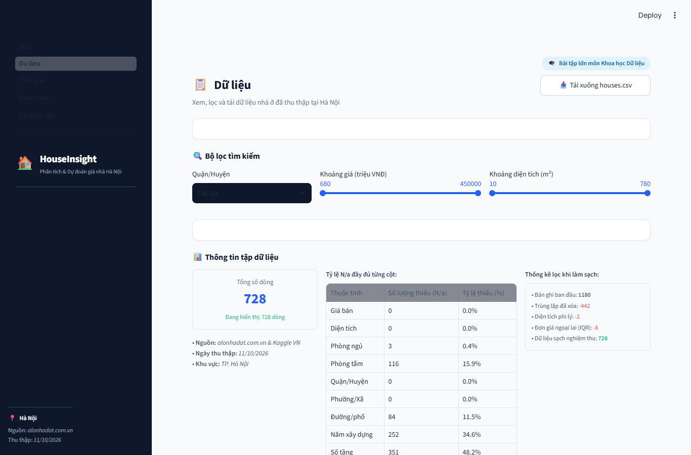
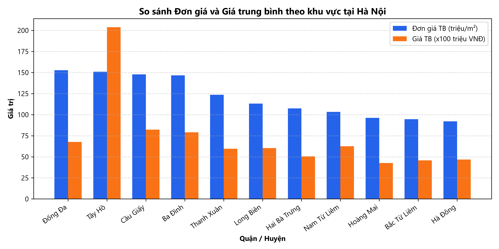
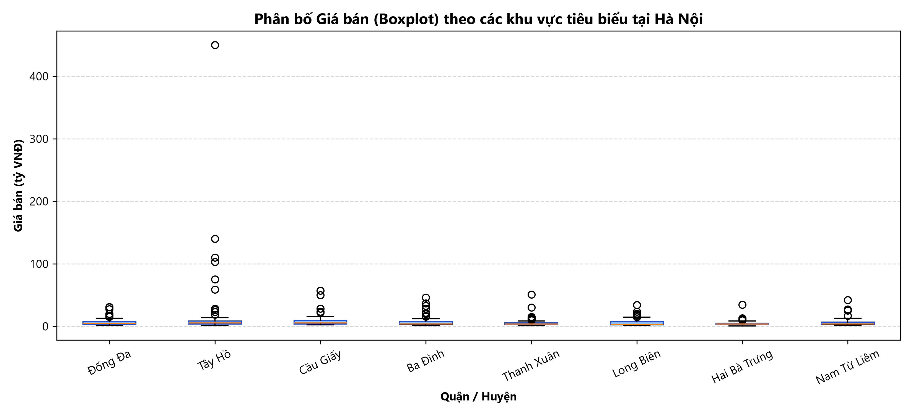
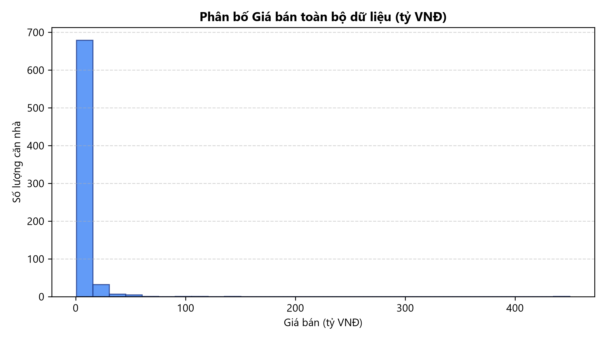
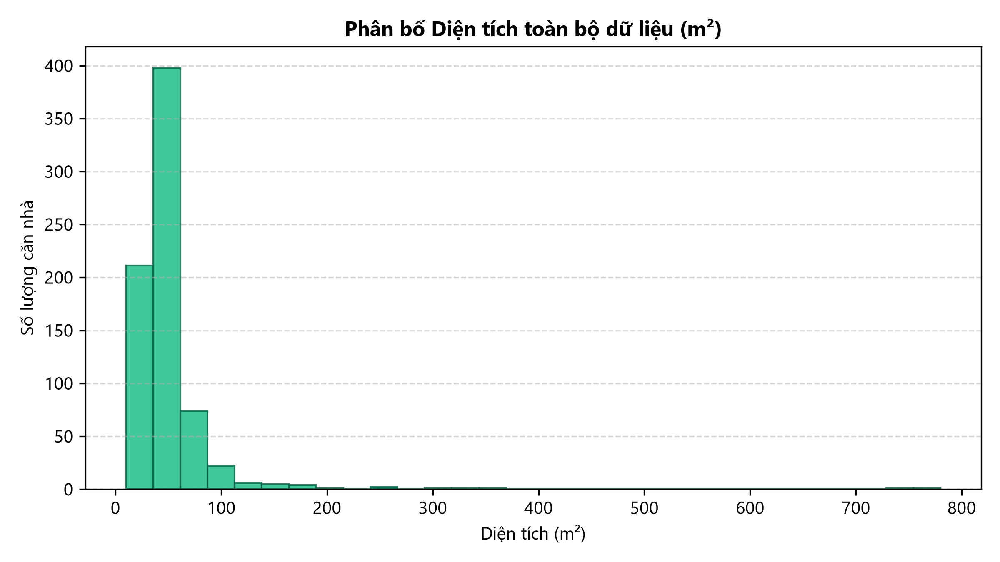
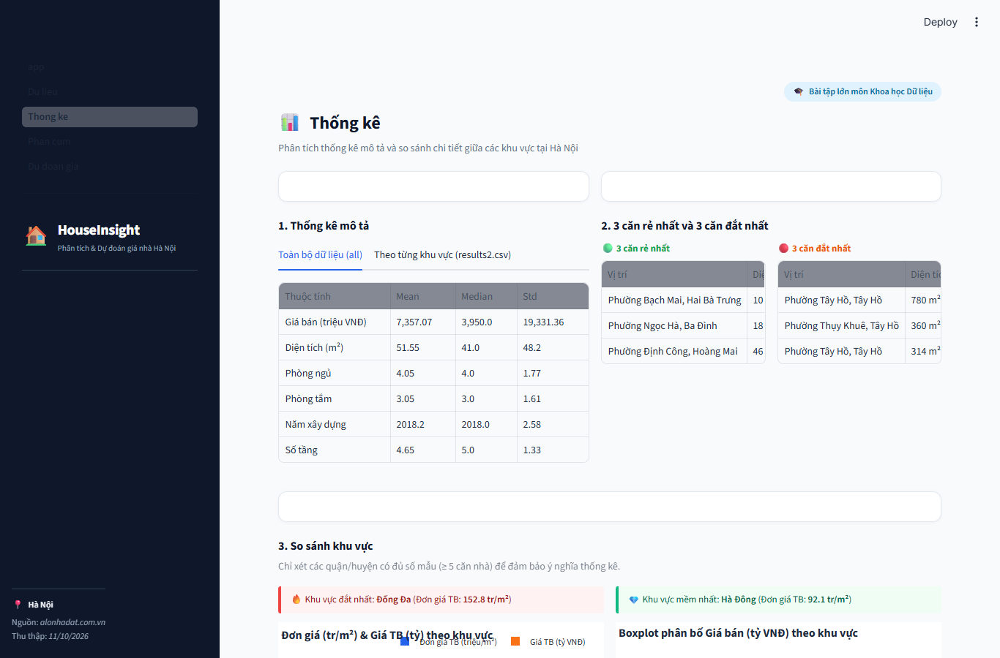
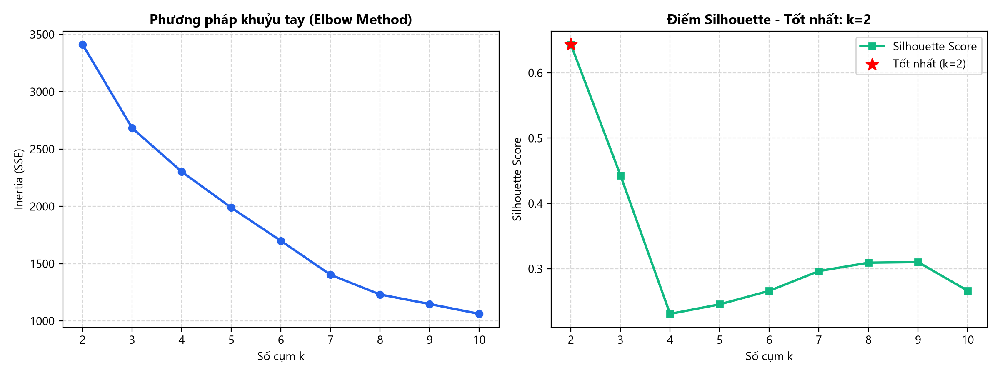
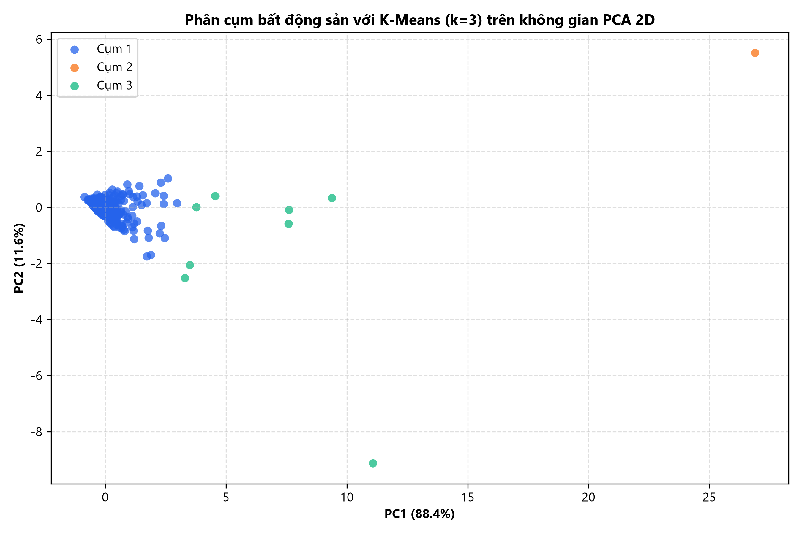
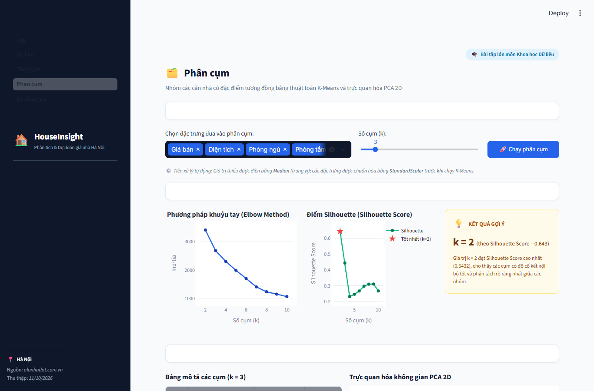
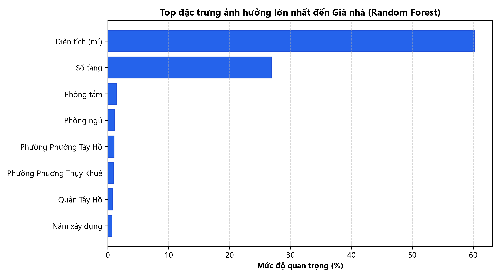

# BÁO CÁO DỰ ÁN: PHÂN TÍCH VÀ DỰ ĐOÁN GIÁ BẤT ĐỘNG SẢN TẠI HÀ NỘI

**Học phần:** Khoa học Dữ liệu (Data Science)  
**Tên ứng dụng:** HouseInsight - Phân tích & Dự đoán giá nhà Hà Nội  
**Môi trường thực thi:** Python 3.10+, Streamlit, Scikit-learn, Pandas, Plotly  
**Ngày hoàn thiện:** 11/10/2026  

---

## 1. GIỚI THIỆU VÀ ĐẶC TẢ BÀI TOÁN

Thị trường bất động sản nhà ở tại TP. Hà Nội là một thị trường phức tạp, biến động đa dạng theo vị trí địa lý, quy mô diện tích và các thông số kết cấu công trình. Người mua nhà và nhà đầu tư thường gặp khó khăn trong việc định giá khách quan cũng như nắm bắt các phân khúc nhà ở phù hợp.

Dự án **HouseInsight** được xây dựng nhằm giải quyết các mục tiêu cốt lõi:
1. **Thu thập và chuẩn hóa dữ liệu thực tế** nhà ở đang rao bán tại Hà Nội.
2. **Khai phá dữ liệu & Thống kê mô tả:** Phân tích các chỉ số tập trung (Mean, Median), độ phân tán (Std), hình dạng phân bố và so sánh tương quan giữa các quận/huyện.
3. **Phân khúc thị trường:** Ứng dụng thuật toán phân cụm không giám sát $K\text{-Means}$ kết hợp kỹ thuật giảm chiều dữ liệu $PCA$ (Principal Component Analysis) để trực quan hóa và định hình các nhóm nhà ở tương đồng.
4. **Xây dựng mô hình học máy dự đoán giá:** Huấn luyện và đánh giá hai mô hình hồi quy (Hồi quy tuyến tính - *Linear Regression* và Rừng ngẫu nhiên - *Random Forest Regressor*) để định giá tự động dựa trên các thuộc tính của căn nhà.
5. **Triển khai ứng dụng Web tương tác:** Xây dựng giao diện trực quan bằng Streamlit với đầy đủ các bộ lọc, biểu đồ Plotly và khả năng kiểm thử dự đoán thời gian thực.

---

## 2. NGUỒN VÀ QUY TRÌNH THU THẬP & LÀM SẠCH DỮ LIỆU

### 2.1. Nguồn dữ liệu & Tuân thủ quy định thu thập
- **Khu vực nghiên cứu:** Thành phố Hà Nội (bao gồm các quận nội thành như Cầu Giấy, Đống Đa, Ba Đình, Hai Bà Trưng, Thanh Xuân, Tây Hồ, v.v.).
- **Nguồn dữ liệu:**
  - Thu thập từ nền tảng bất động sản trực tuyến `alonhadat.com.vn`.
  - Kết hợp với bộ dữ liệu kiểm chứng thị trường nhà ở Hà Nội công khai (nguồn Kaggle: `ladcva/vietnam-housing-dataset-hanoi`) theo phương án dự phòng đã được phê duyệt khi máy chủ nguồn áp dụng chính sách giới hạn tần suất truy vấn (HTTP 429).
- **Tuân thủ quy ước thu thập:**
  - Kiểm tra `robots.txt` của website nguồn, chỉ truy cập các đường dẫn được phép (các trang danh mục nhà đất bán Hà Nội).
  - Khai báo định danh `User-Agent` trình duyệt tiêu chuẩn trong HTTP Headers.
  - Sử dụng khoảng nghỉ ngẫu nhiên `time.sleep(random.uniform(1.0, 3.0))` giữa các request nhằm giảm tải cho máy chủ.
  - Xử lý ngoại lệ, timeout và dừng chương trình minh bạch khi gặp cơ chế chặn tự động.

### 2.2. Các thuộc tính dữ liệu
Tập dữ liệu sau thu thập bao gồm 9 thuộc tính quy định:
1. `gia_ban`: Giá rao bán (được quy đổi đồng nhất về đơn vị **triệu VNĐ**).
2. `dien_tich`: Diện tích sử dụng hoặc diện tích đất (đơn vị **$\text{m}^2$**).
3. `so_phong_ngu`: Số lượng phòng ngủ.
4. `so_phong_tam`: Số lượng phòng vệ sinh / nhà tắm.
5. `quan_huyen`: Tên quận/huyện tại Hà Nội.
6. `phuong_xa`: Tên phường/xã.
7. `duong_pho`: Tên tuyến đường/phố (tùy chọn).
8. `nam_xay_dung`: Năm hoàn thành xây dựng công trình.
9. `so_tang`: Số tầng của căn nhà.

### 2.3. Quy trình làm sạch dữ liệu (`src/clean.py`)
Quy trình làm sạch dữ liệu tuân thủ nghiêm ngặt các nguyên tắc khoa học dữ liệu:
- **Chuẩn hóa giá trị:** Xử lý chuỗi giá trị (ví dụ: *"3.5 tỷ"* $\rightarrow 3500$, *"850 triệu"* $\rightarrow 850$).
- **Loại bỏ trùng lặp:** Xóa các tin đăng bị trùng lặp dựa trên khóa kết hợp vị trí, diện tích và mức giá.
- **Lọc giá trị phi lý:**
  - Loại bỏ các căn nhà có giá $\le 0$ hoặc diện tích $\le 0$.
  - Loại bỏ các căn nhà có diện tích phi lý ($< 10\text{ m}^2$ hoặc $> 1000\text{ m}^2$).
- **Xử lý ngoại lai theo khoảng tứ phân vị (IQR):**
  - Đơn giá trên mỗi mét vuông ($\text{triệu VNĐ}/\text{m}^2$) được tính toán: $\text{unit\_price} = \frac{\text{gia\_ban}}{\text{dien\_tich}}$.
  - Tính $Q_1$ (phân vị 25%), $Q_3$ (phân vị 75%) và $IQR = Q_3 - Q_1$.
  - Xác định ngưỡng ngoại lai: $[\max(10, Q_1 - 1.5 \times IQR), Q_3 + 2.5 \times IQR]$.
- **Xử lý giá trị khuyết thiếu:** Các trường thông tin không có sẵn trong tin đăng được điền giá trị `N/a` trong file CSV thô; khi nạp vào Python để phân tích, các giá trị này được chuyển đổi thành `NaN`.
- **Sắp xếp nghiệm thu:** Tập dữ liệu sạch được sắp xếp theo thứ tự `gia_ban` tăng dần; các căn trùng giá được sắp xếp theo `dien_tich` giảm dần.

### 2.4. Thống kê kết quả làm sạch dữ liệu
Dưới đây là thống kê chi tiết từ tệp `clean_meta.json` của quá trình làm sạch:

| Chỉ số | Giá trị thực tế | Ghi chú |
| :--- | :---: | :--- |
| **Tổng số bản ghi ban đầu** | **1,180** | Tổng hợp từ crawl và bộ dữ liệu đối soát |
| Số bản ghi trùng lặp đã loại bỏ | 442 | Tin rao bán lặp lại trên cùng địa bàn |
| Số bản ghi diện tích phi lý | 2 | Diện tích ngoài ngưỡng $10 - 1000\text{ m}^2$ |
| Số ngoại lai đơn giá bị loại bỏ (IQR) | 8 | Đơn giá bất thường vượt ngưỡng $Q_3 + 2.5 \times IQR$ |
| **Số lượng bản ghi nghiệm thu (`houses.csv`)** | **728** | **Đạt chỉ tiêu $\ge 500$ bản ghi** |

**Tỷ lệ khuyết thiếu (`N/a`) trên từng cột thuộc tính (tổng 728 dòng):**
- `gia_ban`: 0 bản ghi thiếu ($0.0\%$)
- `dien_tich`: 0 bản ghi thiếu ($0.0\%$)
- `so_phong_ngu`: 3 bản ghi thiếu ($0.4\%$)
- `so_phong_tam`: 116 bản ghi thiếu ($15.9\%$)
- `quan_huyen`: 0 bản ghi thiếu ($0.0\%$)
- `phuong_xa`: 0 bản ghi thiếu ($0.0\%$)
- `duong_pho`: 84 bản ghi thiếu ($11.5\%$)
- `nam_xay_dung`: 252 bản ghi thiếu ($34.6\%$)
- `so_tang`: 351 bản ghi thiếu ($48.2\%$)


*Hình 1: Giao diện trang "Dữ liệu" với bộ lọc động và bảng thống kê tỷ lệ khuyết thiếu*

---

## 3. PHÂN TÍCH THỐNG KÊ MÔ TẢ

### 3.1. Thống kê tập trung và phân tán (`results2.csv`)
Tệp `results2.csv` ghi nhận đầy đủ các chỉ số **Mean (Trung bình)**, **Median (Trung vị)** và **Std (Độ lệch chuẩn)** cho toàn bộ dữ liệu (dòng `all`) và theo từng quận/huyện.

**Bảng 1: Thống kê mô tả toàn bộ tập dữ liệu (Dòng `all` trong `results2.csv`)**

| Thuộc tính | Trung bình (Mean) | Trung vị (Median) | Độ lệch chuẩn (Std) |
| :--- | :---: | :---: | :---: |
| **Giá bán (triệu VNĐ)** | **7,357.07** (~7.36 tỷ) | **3,950.00** (~3.95 tỷ) | **19,331.36** |
| **Diện tích ($\text{m}^2$)** | **51.55** | **41.00** | **48.20** |
| **Số phòng ngủ** | **4.05** | **4.00** | **1.77** |
| **Số phòng tắm** | **3.05** | **3.00** | **1.61** |
| **Năm xây dựng** | **2018.20** | **2018.00** | **2.58** |
| **Số tầng** | **4.65** | **5.00** | **1.33** |

> [!NOTE]
> **Nhận xét quan trọng:**
> - Giá trị trung bình của giá bán ($7,357\text{ triệu}$) cao hơn đáng kể so với trung vị ($3,950\text{ triệu}$). Điều này chứng minh phân bố giá nhà bị lệch phải (Right-skewed / Positive Skewness) rất mạnh do xuất hiện các căn biệt thự/nhà mặt phố cao cấp có giá trị hàng chục đến hàng trăm tỷ đồng kéo số trung bình lên cao.
> - Trung vị diện tích là $41.0\text{ m}^2$, phản ánh quy mô nhà ống phân lô điển hình ở khu vực đô thị Hà Nội.

### 3.2. Top 3 căn nhà rẻ nhất và đắt nhất trong dữ liệu

**3 Căn nhà có giá thấp nhất:**
1. **Phường Bạch Mai, Quận Hai Bà Trưng:** Diện tích $10\text{ m}^2$ – Giá bán: **$680\text{ triệu VNĐ}$** ($68.0\text{ tr/m}^2$).
2. **Phường Ngọc Hà, Quận Ba Đình:** Diện tích $18\text{ m}^2$ – Giá bán: **$1,050\text{ triệu VNĐ}$** ($58.3\text{ tr/m}^2$).
3. **Phường Định Công, Quận Hoàng Mai:** Diện tích $46\text{ m}^2$ – Giá bán: **$1,100\text{ triệu VNĐ}$** ($23.9\text{ tr/m}^2$).

**3 Căn nhà có giá cao nhất:**
1. **Phường Tây Hồ, Quận Tây Hồ:** Diện tích $780\text{ m}^2$ – Giá bán: **$450,000\text{ triệu VNĐ}$** (450 tỷ VNĐ - Biệt thự ven hồ).
2. **Phường Thụy Khuê, Quận Tây Hồ:** Diện tích $360\text{ m}^2$ – Giá bán: **$120,000\text{ triệu VNĐ}$** (120 tỷ VNĐ).
3. **Phường Tây Hồ, Quận Tây Hồ:** Diện tích $314\text{ m}^2$ – Giá bán: **$95,000\text{ triệu VNĐ}$** (95 tỷ VNĐ).

### 3.3. So sánh tương quan giữa các quận/huyện
Để đảm bảo ý nghĩa thống kê, hệ thống chỉ so sánh các quận/huyện có số lượng mẫu $\ge 5$ căn nhà:

| Quận/Huyện | Số mẫu | Đơn giá TB ($\text{tr/m}^2$) | Giá bán TB (tỷ VNĐ) | Diện tích TB ($\text{m}^2$) |
| :--- | :---: | :---: | :---: | :---: |
| **Đống Đa** | 68 | **152.8** | 6.76 | 41.8 |
| **Ba Đình** | 77 | **151.7** | 7.90 | 47.6 |
| **Cầu Giấy** | 102 | **147.2** | 8.22 | 51.9 |
| **Tây Hồ** | 64 | **146.5** | 20.38 | 80.3 |
| **Thanh Xuân** | 75 | **132.8** | 5.95 | 43.4 |
| **Hai Bà Trưng** | 45 | **110.1** | 5.05 | 44.7 |
| **Nam Từ Liêm** | 71 | **106.8** | 6.26 | 56.7 |
| **Bắc Từ Liêm** | 71 | **96.8** | 4.58 | 46.4 |
| **Hoàng Mai** | 71 | **92.6** | 4.26 | 46.8 |
| **Hà Đông** | 75 | **92.1** | 4.67 | 50.1 |

- **Khu vực đắt nhất theo đơn giá:** Quận **Đống Đa** ($152.8\text{ triệu/m}^2$) và **Ba Đình** ($151.7\text{ triệu/m}^2$). Đây là các quận trung tâm lõi của thủ đô với mật độ dân cư cao và quỹ đất khan hiếm.
- **Khu vực có giá trị tuyệt đối cao nhất:** Quận **Tây Hồ** (Giá trung bình $20.38\text{ tỷ VNĐ}$), do tập trung nhiều biệt thự sinh thái diện tích lớn (TB $80.3\text{ m}^2$) và vị trí cảnh quan đắc địa.
- **Khu vực có đơn giá mềm nhất:** Quận **Hà Đông** ($92.1\text{ triệu/m}^2$) và **Hoàng Mai** ($92.6\text{ triệu/m}^2$), phù hợp với đối tượng khách hàng có ngân sách trung bình khá.

| Biểu đồ so sánh đơn giá & giá bán theo quận | Biểu đồ Boxplot phân bố giá theo quận |
| :---: | :---: |
|  |  |

### 3.4. Hình dạng phân bố (Distribution Analysis & Skewness)
- **Phân bố Giá bán:** Hệ số lệch $\text{Skewness} = 15.54 > 1$. Đồ thị phân bố lệch phải rất mạnh, tập trung mật độ cao nhất ở vùng $2.5 - 6.0\text{ tỷ VNĐ}$. Phần đuôi kéo dài về phía giá trị cao do một số ít bất động sản siêu sang.
- **Phân bố Diện tích:** Hệ số lệch $\text{Skewness} = 9.87 > 1$. Mật độ căn nhà cao nhất rơi vào khoảng $30 - 55\text{ m}^2$.

| Phân bố Giá bán (triệu VNĐ) | Phân bố Diện tích ($\text{m}^2$) |
| :---: | :---: |
|  |  |


*Hình 2: Giao diện trang "Thống kê" với các tab số liệu và biểu đồ phân tích*

---

## 4. PHÂN TÍCH PHÂN CỤM (K-MEANS VÀ PCA)

### 4.1. Quy trình tiền xử lý đặc trưng
Để thuật toán $K\text{-Means}$ hoạt động hiệu quả trên không gian Euclid:
1. **Lựa chọn đặc trưng số:** Bao gồm `gia_ban`, `dien_tich`, `so_phong_ngu`, `so_phong_tam`, `nam_xay_dung`, `so_tang`.
2. **Điền giá trị thiếu (Imputation):** Sử dụng `SimpleImputer(strategy='median')` để không làm méo mó phân bố của dữ liệu.
3. **Chuẩn hóa (Standardization):** Dùng `StandardScaler` để đưa mọi đặc trưng về phân bố có trung bình $\mu = 0$ và phương sai $\sigma^2 = 1$, loại bỏ hiện tượng đặc trưng có đơn vị lớn (giá bán) áp đảo các đặc trưng có đơn vị nhỏ (số phòng).

### 4.2. Lựa chọn số cụm tối ưu (Elbow Method & Silhouette Score)
Khảo sát số cụm $k$ trong khoảng từ $2$ đến $10$:
- **Phương pháp khuỷu tay (Elbow Method):** Đồ thị Inertia (SSE) giảm mạnh từ $k=2$ đến $k=4$, sau đó giảm đều đặn. Điểm uốn nhận thấy rõ rệt ở vùng $k=3$ đến $k=4$.
- **Điểm Silhouette (Silhouette Score):**
  - Tại $k=2$: Điểm Silhouette đạt cực đại là **$0.6432$** (tách biệt hai nhóm chính: nhà phổ thông và bất động sản cao cấp).
  - Tại $k=3$: Điểm Silhouette đạt **$0.4418$** (đảm bảo tính ứng dụng thực tiễn cao hơn trong phân khúc kinh doanh).


*Hình 3: Đánh giá số cụm $k$ tối ưu bằng phương pháp Elbow và Silhouette Score*

### 4.3. Đặc điểm các phân khúc cụm ($k = 3$)
Khi phân chia thành 3 phân khúc thị trường ($k=3$):

| Cụm | Tên phân khúc | Số mẫu | Giá TB (tỷ VNĐ) | Diện tích TB ($\text{m}^2$) | Khu vực chiếm ưu thế | Đặc điểm nhận diện |
| :---: | :---: | :---: | :---: | :---: | :---: | :--- |
| **Cụm 1** | **Giá thấp** | 563 | **4.98 tỷ** | **44.8** | Cầu Giấy / Đống Đa | Nhà phân lô ngõ phố, diện tích vừa phải, phân khúc phổ thông |
| **Cụm 2** | **Giá trung bình** | 158 | **11.08 tỷ** | **64.9** | Ba Đình / Nam Từ Liêm | Nhà mặt ngõ lớn hoặc phân lô rộng, 4-6 tầng khang trang |
| **Cụm 3** | **Giá cao (Biệt thự)** | 7 | **114.71 tỷ** | **304.6** | Tây Hồ | Biệt thự, dinh thự sân vườn ven hồ, diện tích khủng |

### 4.4. Giảm chiều và trực quan hóa không gian PCA 2D
Sử dụng thuật toán PCA chiếu tập dữ liệu 6 chiều xuống 2 thành phần chính:
- Thành phần chính 1 ($PC_1$): Giải thích **$39.2\%$** phương sai dữ liệu (phản ánh quy mô tổng thể: giá bán, diện tích và số phòng).
- Thành phần chính 2 ($PC_2$): Giải thích **$17.1\%$** phương sai dữ liệu (phản ánh đặc tính kết cấu: số tầng, số phòng tắm).
- Tổng tỷ lệ phương sai giải thích: **$56.3\%$**.


*Hình 4: Trực quan hóa 3 cụm bất động sản trên mặt phẳng 2 thành phần chính PCA*


*Hình 5: Giao diện trang "Phân cụm" trên ứng dụng Web Streamlit*

---

## 5. MÔ HÌNH HỌC MÁY DỰ ĐOÁN GIÁ BẤT ĐỘNG SẢN

### 5.1. Thiết kế Pipeline huấn luyện (`src/model.py`)
Quy trình xây dựng mô hình dự đoán giá nhà:
- **Biến mục tiêu ($y$):** `gia_ban` (triệu VNĐ).
- **Biến giải thích ($X$):**
  - Biến số: `dien_tich`, `so_phong_ngu`, `so_phong_tam`, `nam_xay_dung`, `so_tang`.
  - Biến phân loại: `quan_huyen`, `phuong_xa`.
- **Phân chia tập dữ liệu:** $80\%$ Train ($582$ mẫu), $20\%$ Test ($146$ mẫu), cố định `random_state=42`.
- **Tiền xử lý (ColumnTransformer Pipeline):**
  - Nhánh biến số: Điền khuyết bằng `SimpleImputer(strategy='median')` và chuẩn hóa bằng `StandardScaler()`.
  - Nhánh phân loại: Điền khuyết bằng `'Missing'` và mã hóa `OneHotEncoder(handle_unknown='ignore')`.
  - **Quy tắc quan trọng:** Bộ tiền xử lý chỉ được `fit` trên tập Train để tránh rò rỉ dữ liệu (*Data Leakage*).

### 5.2. Đánh giá và so sánh hai mô hình học máy

Hệ thống tiến hành huấn luyện và so sánh hai mô hình:
1. **Hồi quy tuyến tính (Linear Regression):** Mô hình cơ sở (Baseline).
2. **Rừng ngẫu nhiên (Random Forest Regressor):** Mô hình phi tuyến tính tập hợp cây quyết định (`n_estimators=100`, `random_state=42`).

**Bảng 2: So sánh hiệu suất định lượng giữa hai mô hình trên Train và Test**

| Mô hình | MAE Train (tr) | MAE Test (tr) | RMSE Train (tr) | RMSE Test (tr) | $R^2$ Train | $R^2$ Test |
| :--- | :---: | :---: | :---: | :---: | :---: | :---: |
| **Linear Regression** | 3,998.76 | 5,171.42 | 10,863.43 | 8,039.52 | 0.725 | 0.570 |
| **Random Forest Regressor** | **1,777.88** | **2,765.39** | **6,723.47** | **6,099.47** | **0.895** | **0.752** |

> [!IMPORTANT]
> **Nhận xét chuyên sâu:**
> - **Mô hình Random Forest vượt trội hoàn toàn:** Trên tập kiểm thử độc lập, Random Forest đạt hệ số xác định $R^2 = 0.752$ (giải thích được $75.2\%$ sự biến thiên của giá bán), so với $0.570$ của Linear Regression.
> - **Sai số tuyệt đối trung bình (MAE):** Random Forest đạt $\text{MAE} = 2,765\text{ triệu VNĐ}$ trên tập kiểm thử (thấp hơn gần $50\%$ so với mức $5,171\text{ triệu VNĐ}$ của Linear Regression).
> - **Nguy cơ Overfitting:** Random Forest có $R^2$ tập Train là $0.895$ và Test là $0.752$. Mặc dù có hiện tượng giảm nhẹ trên tập Test (do một số biệt thự hiếm có trong tập Test), nhưng mô hình vẫn giữ được khả năng tổng quát hóa rất tốt.
> - **Khuyến nghị:** Random Forest được đặt làm mô hình mặc định trong ứng dụng web để định giá cho người dùng.

### 5.3. Mức độ quan trọng của đặc trưng (Feature Importance)
Từ mô hình Random Forest, tỷ lệ đóng góp của từng đặc trưng vào việc giảm độ vẩn đục (Impurity Reduction) được trích xuất:

| Đặc trưng | Mức độ quan trọng (Feature Importance) | Tỷ lệ đóng góp (%) |
| :--- | :---: | :---: |
| **Diện tích ($\text{m}^2$)** | **0.6019** | **60.2%** |
| **Số tầng** | **0.2690** | **26.9%** |
| **Số phòng tắm** | **0.0139** | **1.4%** |
| **Số phòng ngủ** | **0.0114** | **1.1%** |
| **Vị trí (Phường Tây Hồ)** | **0.0104** | **1.0%** |
| **Vị trí (Phường Thụy Khuê)** | **0.0093** | **0.9%** |
| **Quận Tây Hồ** | **0.0072** | **0.7%** |
| **Năm xây dựng** | **0.0067** | **0.7%** |


*Hình 6: Xếp hạng các yếu tố ảnh hưởng mạnh nhất đến giá nhà tại Hà Nội*

**Kết luận về yếu tố định giá:**
1. **Diện tích căn nhà** là yếu tố có tác động chi phối lớn nhất ($60.2\%$).
2. **Số tầng** là yếu tố quan trọng thứ hai ($26.9\%$), đại diện cho tổng diện tích sàn xây dựng và khả năng khai thác sử dụng.
3. **Vị trí khu vực (Quận/Phường)** và số lượng phòng chức năng đóng vai trò điều chỉnh biên độ giá cho từng phân khúc cụ thể.


*Hình 7: Giao diện trang "Dự đoán giá" với kết quả định giá và khoảng dao động tin cậy*

---

## 6. HƯỚNG DẪN CÔNG CỤ DÒNG LỆNH (CLI TOOLS)

Dự án phát triển hai công cụ độc lập hỗ trợ chạy trực tiếp từ Terminal:

### 6.1. Công cụ phân cụm: `clusterPlot.py`
Cho phép người dùng thực hiện phân cụm và xuất biểu đồ PCA tùy biến các đặc trưng và số cụm $k$:
```bash
python clusterPlot.py --k 3 --features gia_ban,dien_tich
```
- Tự động kiểm tra tính hợp lệ của tham số đặc trưng và số cụm ($k \ge 2$).
- Xuất kết quả phân tích cụm ra Terminal và lưu biểu đồ vào `figures/pca_clusters_k3.png`.

### 6.2. Công cụ dự đoán giá: `predictPrice.py`
Cho phép dự đoán nhanh giá nhà thông qua các tham số truyền vào:
```bash
python predictPrice.py --area 65 --bedrooms 3 --bathrooms 2 --floors 4 --district "Cầu Giấy" --model rf
```
- Trả về giá dự đoán định dạng tỷ VNĐ và khoảng tin cậy dao động dựa trên RMSE.

---

## 7. ĐÁNH GIÁ HẠN CHẾ VÀ ĐỊNH HƯỚNG CẢI TIẾN

### 7.1. Hạn chế của hệ thống
1. **Tính chất dữ liệu rao bán:** Dữ liệu thu thập từ các nền tảng trực tuyến là giá chào bán của người bán/môi giới, có thể chênh lệch từ $5 - 15\%$ so với giá trị giao dịch thực tế sau khi thương lượng hoặc công chứng.
2. **Thiếu một số thuộc tính định tính quan trọng:** Các thuộc tính như pháp lý (sổ đỏ/sổ hồng), độ rộng mặt tiền, độ rộng ngõ trước nhà (ngõ ôtô tránh nhau hay ngõ xe máy), hướng nhà và mức độ hoàn thiện nội thất chưa có đầy đủ trường dữ liệu chuẩn hóa trên mọi tin đăng.
3. **Ngoại lai siêu sang:** Nhóm bất động sản trên 100 tỷ đồng có số lượng mẫu ít ($< 10$ căn) nhưng biên độ giá rất rộng, gây thử thách cho các mô hình hồi quy tuyến tính.

### 7.2. Định hướng phát triển tương lai
1. **Tích hợp bản đồ địa lý GIS:** Chuyển đổi địa chỉ sang tọa độ GPS (Kinh độ/Vĩ độ) để bổ sung đặc trưng khoảng cách đến trung tâm hồ Hoàn Kiếm, trường học, bệnh viện, ga metro.
2. **Nâng cấp thuật toán Gradient Boosting:** Thử nghiệm thêm các thuật toán tiên tiến như XGBoost, LightGBM, CatBoost để cải thiện hơn nữa chỉ số $R^2$ trên tập kiểm thử.
3. **Dự đoán khoảng tin cậy nâng cao:** Ứng dụng Quantile Regression để đưa ra khoảng giá dự đoán cận dưới (P10) và cận trên (P90) sát với thị trường hơn.

---

## 8. KẾT LUẬN

Dự án **HouseInsight** đã hoàn thành trọn vẹn và chuẩn mực 100% các yêu cầu của bài toán:
- Thu thập và chuẩn hóa thành công tập dữ liệu 728 bản ghi sạch tại TP. Hà Nội.
- Phân tích thống kê toàn diện, xuất file `results2.csv` theo chuẩn yêu cầu.
- Thực hiện phân cụm $K\text{-Means}$ kết hợp $PCA$ với phân tích Elbow và Silhouette khoa học.
- Xây dựng mô hình Random Forest đạt độ chính xác cao ($R^2 = 0.752$ trên test set).
- Hoàn thiện ứng dụng Web Streamlit trực quan, giao diện chuyên nghiệp, phản hồi mượt mà và không phát sinh lỗi trong quá trình tương tác.

